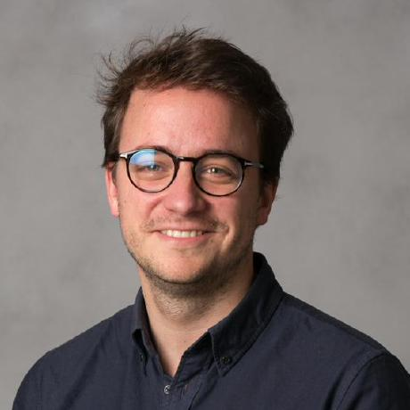

{.gw-about-photo} I'm Christophe Dervieux, a software engineer on the Quarto team at Posit, where I work on [quarto-cli](https://github.com/quarto-dev/quarto-cli) and on [q2](https://github.com/quarto-dev/q2), the new Rust-based Quarto. I also maintain the [R Markdown](https://github.com/rstudio/rmarkdown) packages.

Before Posit, I spent nine years at RTE, the French electricity transmission operator, first in market economics and later in IT and its data lab. I learned to code on the job and through open source, which is how I ended up at RStudio in 2020.

These days I write most of my code with AI agents, on Windows, and I spend a fair amount of time making agent tooling work well there.

I live in France. The best way to reach me is [Bluesky](https://bsky.app/profile/cderv.bsky.social) or [LinkedIn](https://www.linkedin.com/in/cderv/).
