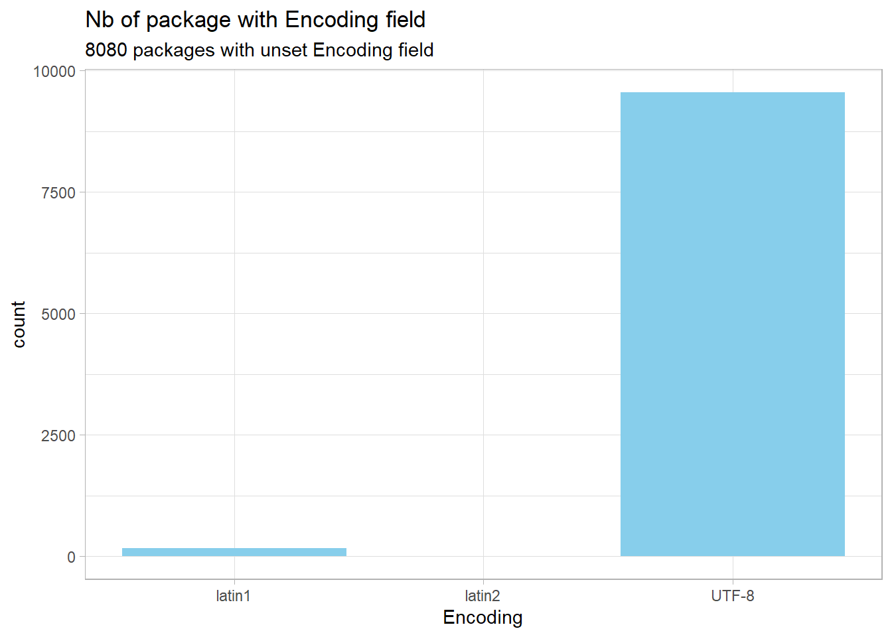
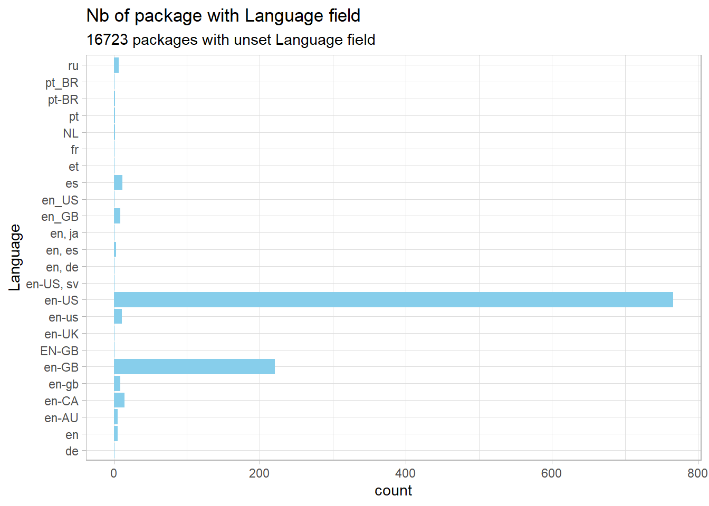
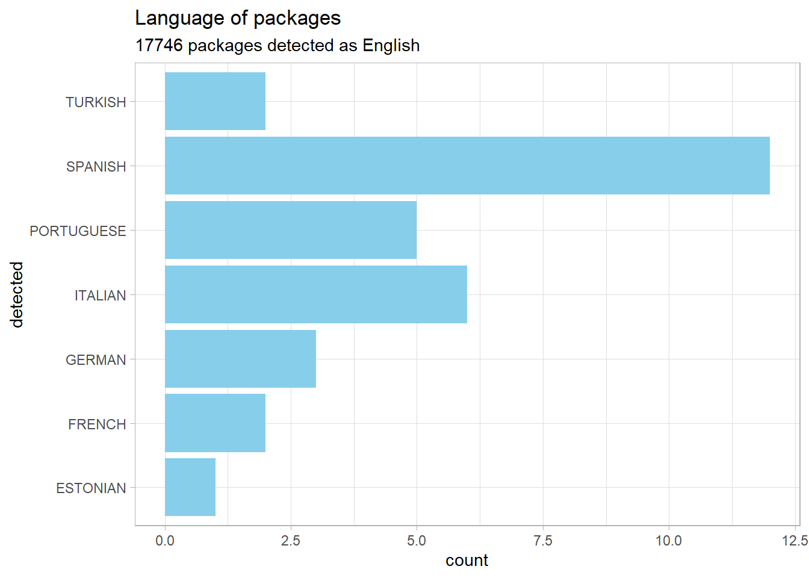

<!--
Ported from the Hugo/blogdown blog with frozen outputs: R code is not
executed. Printed output, tables and figures were copied from the
blogdown-rendered index.html and index_files/figure-html/ of the old post.
-->

Trying to figure out how encoding work in 📦 for writing french DESCRIPTION and manual files, I was wondering if others packages on CRAN as been wrote in French or any other non english language.

```r
library(tidyverse)
```

# Looking into the cran database

First, we load the cran database with all information about description fields. We keep only some fields that can helps us look for not english packages. (For a list of all the fields meaning, read [Writing R Extensions](https://cran.r-project.org/doc/manuals/r-release/R-exts.html#The-DESCRIPTION-file))

```r
to_keep  <- c("Package", "Title", "Description", "Encoding", "Language")
cran_db <- tools::CRAN_package_db()[to_keep] %>% as_tibble()
glimpse(cran_db)
```

```
## Rows: 17,802
## Columns: 5
## $ Package     <chr> "A3", "aaSEA", "AATtools", "ABACUS", "abbyyR", "abc", "abc~
## $ Title       <chr> "Accurate, Adaptable, and Accessible Error Metrics for Pre~
## $ Description <chr> "Supplies tools for tabulating and analyzing the results o~
## $ Encoding    <chr> NA, "UTF-8", "UTF-8", "UTF-8", NA, NA, NA, "UTF-8", "UTF-8~
## $ Language    <chr> NA, NA, NA, NA, NA, NA, NA, NA, NA, NA, NA, NA, NA, NA, NA~
```

Let's see how many package set their Encoding field in their DESCRIPTION

```r
nb_of_na <- cran_db %>% filter(is.na(Encoding)) %>% count(Encoding) %>% pull(n)
ggplot(cran_db %>% filter(!is.na(Encoding))) +
  geom_bar(aes(x = Encoding), fill = "skyblue") +
  labs(title = "Nb of package with Encoding field", subtitle = glue::glue("{nb_of_na} packages with unset Encoding field")) +
  theme_light()
```

{fig-alt="Bar chart: Nb of package with Encoding field" width=672}

Is there any package that uses a Language field in their DESCRIPTION ?

```r
nb_of_na <- cran_db %>% filter(is.na(Language)) %>% count(Language) %>% pull(n)
ggplot(cran_db %>% filter(!is.na(Language))) +
  geom_bar(aes(x = Language), fill = "skyblue") +
  labs(title = "Nb of package with Language field", subtitle = glue::glue("{nb_of_na} packages with unset Language field")) +
  coord_flip() +
  theme_light()
```

{fig-alt="Bar chart: Nb of package with Language field" width=672}

So there are some package that declares their Language field in the DESCRIPTION. These field means:

> A ‘Language’ field can be used to indicate if the package documentation is not in English: this should be a comma-separated list of standard (not private use or grandfathered) IETF language tags as currently defined by RFC 5646 (<https://tools.ietf.org/html/rfc5646>, see also <https://en.wikipedia.org/wiki/IETF_language_tag>), i.e., use language subtags which in essence are 2-letter ISO 639-1 (<https://en.wikipedia.org/wiki/ISO_639-1>) or 3-letter ISO 639-3 (<https://en.wikipedia.org/wiki/ISO_639-3>) language codes.

Which are those packages ?

```r
cran_db %>%
  filter(Language == "fr") %>%
  pander::pandoc.table(split.tables = Inf)
```

```{=html}
<table>
<colgroup>
<col width="13%" />
<col width="31%" />
<col width="32%" />
<col width="10%" />
<col width="10%" />
</colgroup>
<thead>
<tr class="header">
<th align="center">Package</th>
<th align="center">Title</th>
<th align="center">Description</th>
<th align="center">Encoding</th>
<th align="center">Language</th>
</tr>
</thead>
<tbody>
<tr class="odd">
<td align="center">SARP.moodle</td>
<td align="center">XML Output Functions for Easy
Creation of Moodle Questions</td>
<td align="center">Provides a set of basic
functions for creating Moodle
XML output files suited for
importing questions in Moodle
(a learning management
system, see
<a href="https://moodle.org/" class="uri">https://moodle.org/</a> for more
information).</td>
<td align="center">UTF-8</td>
<td align="center">fr</td>
</tr>
</tbody>
</table>
```

We see that neither of these packages have their title or description field in
french. Moreover, one package has UTF8 encoding and the other Latin1.

So this Language field is not very useful. I am not sure if this field is useful
for any other purpose than information

# Trying to detect languages of Packages

How can we have some insight on CRAN package language ?

We can analyse the cran database using the Google's Compact Language Detector. ROpensci has made 2 wrappers for using it in version 2 ([`cld2`](https://github.com/ropensci/cld2)) and version 3 ([`cld3`](https://github.com/ropensci/cld3)).

We will be using the version 2, as `cld3` is still experimental.

```r
cran_db_with_lang <- cran_db %>%
  mutate(detected = cld2::detect_language(Description, lang_code = FALSE))
```

```r
nb_of_lg_en <- cran_db_with_lang %>% filter(detected == "ENGLISH") %>% count(detected) %>% pull(n)
ggplot(cran_db_with_lang %>% filter(detected != "ENGLISH")) +
  geom_bar(aes(x = detected), fill = "skyblue") +
  labs(title = "Language of packages", subtitle = glue::glue("{nb_of_lg_en} packages detected as English")) +
  coord_flip() +
  theme_light()
```

{fig-alt="Bar chart: Language of packages" width=672}

There are very few packages that seems to have non english description field.

```{=html}
<table>
<colgroup>
<col width="10%" />
<col width="15%" />
<col width="58%" />
<col width="5%" />
<col width="5%" />
<col width="5%" />
</colgroup>
<thead>
<tr class="header">
<th align="center">Package</th>
<th align="center">Title</th>
<th align="center">Description</th>
<th align="center">Encoding</th>
<th align="center">Language</th>
<th align="center">detected</th>
</tr>
</thead>
<tbody>
<tr class="odd">
<td align="center">casen</td>
<td align="center">Metodos De Estimacion Con
Disenio Probabilistico y
Estratificado en Encuesta
CASEN (Estimation Methods with
Probabilistic Stratified
Sampling in CASEN Survey)</td>
<td align="center">Funciones para realizar
estadistica descriptiva e
inferencia con el disenio
complejo de la Encuesta CASEN
(Encuesta de Caracterizacion
Socio-Economica). Incluye
datasets que permiten
armonizar los codigos de
comunas que cambian entre
anios y permite convertir a
los codigos oficiales de
SUBDERE. (Functions to
compute descriptive and
inferential statistics with
CASEN Survey [Socio-Economic
Characterization Survey]
complex design. Includes
datasets to harmonize commune
codes that change across years
and allows to convert to
official SUBDERE codes.)</td>
<td align="center">UTF-8</td>
<td align="center">NA</td>
<td align="center">SPANISH</td>
</tr>
<tr class="even">
<td align="center">censo2017</td>
<td align="center">Base de Datos de Facil Acceso
del Censo 2017 de Chile (2017
Chilean Census Easy Access
Database)</td>
<td align="center">Provee un acceso conveniente a
mas de 17 millones de
registros de la base de
datos del Censo 2017. Los
datos fueron importados desde
el DVD oficial del INE
usando el Convertidor REDATAM
creado por Pablo De
Grande. Esta paquete esta
documentado intencionalmente
en castellano asciificado
para que funcione sin problema
en diferentes plataformas.
(Provides convenient access to
more than 17 million records
from the Chilean Census
2017 database. The datasets
were imported from the
official DVD provided by
the Chilean National Bureau of
Statistics by using the
REDATAM converter created by
Pablo De Grande and in
addition it includes the
maps accompanying these
datasets.)</td>
<td align="center">UTF-8</td>
<td align="center">NA</td>
<td align="center">SPANISH</td>
</tr>
<tr class="odd">
<td align="center">chilemapas</td>
<td align="center">Mapas de las Divisiones
Politicas y Administrativas de
Chile (Maps of the Political
and Administrative Divisions
of Chile)</td>
<td align="center">Mapas terrestres con
topologias simplificadas.
Estos mapas no tienen
precision geodesica, por lo
que aplica el DFL-83 de 1979
de la Republica de Chile y
se consideran referenciales
sin validez legal. No se
incluyen los territorios
antarticos y bajo ningun
evento estos mapas
significan que exista una
cesion u ocupacion de
territorios soberanos en
contra del Derecho
Internacional por parte de
Chile. Esta paquete esta
documentado intencionalmente
en castellano asciificado para
que funcione sin problema
en diferentes plataformas.
(Terrestrial maps with
simplified toplogies. These
maps lack geodesic
precision, therefore DFL-83
1979 of the Republic of Chile
applies and are considered
to have no legal validity.
Antartic territories are
excluded and under no event
these maps mean there is a
cession or occupation of
sovereign territories against
International Laws from
Chile. This package was
intentionally documented in
asciified spanish to make it
work without problem on
different platforms.)</td>
<td align="center">UTF-8</td>
<td align="center">NA</td>
<td align="center">SPANISH</td>
</tr>
<tr class="even">
<td align="center">confreq</td>
<td align="center">Configural Frequencies
Analysis Using Log-Linear
Modeling</td>
<td align="center">Offers several functions for
Configural Frequencies
Analysis (CFA), which is a
useful statistical tool for
the analysis of multiway
contingency tables. CFA was
introduced by G. A. Lienert as
‘Konfigurations Frequenz
Analyse - KFA’. Lienert, G. A.
(1971). Die
Konfigurationsfrequenzanalyse:
I. Ein neuer Weg zu Typen und
Syndromen. Zeitschrift
für Klinische Psychologie und
Psychotherapie, 19(2), 99–115.</td>
<td align="center">UTF-8</td>
<td align="center">NA</td>
<td align="center">GERMAN</td>
</tr>
<tr class="odd">
<td align="center">covid19italy</td>
<td align="center">The 2019 Novel Coronavirus
COVID-19 (2019-nCoV) Italy
Dataset</td>
<td align="center">Provides a daily summary of
the Coronavirus (COVID-19)
cases in Italy by country,
region and province level.
Data source: Presidenza del
Consiglio dei Ministri -
Dipartimento della Protezione
Civile
<a href="http://www.protezionecivile.it/" class="uri">http://www.protezionecivile.it/</a>.</td>
<td align="center">UTF-8</td>
<td align="center">NA</td>
<td align="center">ITALIAN</td>
</tr>
<tr class="even">
<td align="center">datos</td>
<td align="center">Traduce al Español Varios
Conjuntos de Datos de Práctica</td>
<td align="center">Provee una versión traducida
de los siguientes
conjuntos de datos:
‘airlines’, ‘airports’,
‘AwardsManagers’,
‘babynames’, ‘Batting’,
‘diamonds’, ‘faithful’,
‘fueleconomy’, ‘Fielding’,
‘flights’, ‘gapminder’,
‘gss_cat’, ‘iris’, ‘Managers’,
‘mpg’, ‘mtcars’, ‘atmos’,
‘People, ’Pitching’, ‘planes’,
‘presidential’, ‘table1’,
‘table2’, ‘table3’, ‘table4a’,
‘table4b’, ‘table5’,
‘vehicles’, ‘weather’, ‘who’.
English: It provides a
Spanish translated version of
the datasets listed above.</td>
<td align="center">UTF-8</td>
<td align="center">es</td>
<td align="center">SPANISH</td>
</tr>
<tr class="odd">
<td align="center">ExpDes.pt</td>
<td align="center">Pacote Experimental Designs
(Portugues)</td>
<td align="center">Pacote para análise de
delineamentos experimentais
(DIC, DBC e DQL), experimentos
em esquema fatorial duplo (em
DIC e DBC), experimentos em
parcelas subdivididas (em DIC
e DBC), experimentos em
esquema fatorial duplo com um
tratamento adicional (em DIC e
DBC), experimentos em fatorial
triplo (em DIC e DBC) e
experimentos em esquema
fatorial triplo com um
tratamento adicional (em DIC e
DBC), fazendo analise de
variancia e comparacao de
multiplas medias (para
tratamentos qualitativos), ou
ajustando modelos de regressao
ate a terceira potencia (para
tratamentos quantitativos);
analise de residuos (Ferreira,
Cavalcanti and Nogueira, 2014)
<a href="doi:10.4236/am.2014.519280" class="uri">doi:10.4236/am.2014.519280</a>.</td>
<td align="center">UTF-8</td>
<td align="center">NA</td>
<td align="center">PORTUGUESE</td>
</tr>
<tr class="even">
<td align="center">geouy</td>
<td align="center">Geographic Information of
Uruguay</td>
<td align="center">The toolbox have functions to
load and process geographic
information for Uruguay.
And extra-function to get
address coordinates and
orthophotos through the
uruguayan ‘IDE’ API
<a href="https://www.gub.uy/infraestructura-datos-espaciales/tramites-y-servicios/servicios/servicio-direcciones-geograficas" class="uri">https://www.gub.uy/infraestructura-datos-espaciales/tramites-y-servicios/servicios/servicio-direcciones-geograficas</a>.</td>
<td align="center">UTF-8</td>
<td align="center">en, es</td>
<td align="center">SPANISH</td>
</tr>
<tr class="odd">
<td align="center">guaguas</td>
<td align="center">Nombres Inscritos en Chile
(1920 - 2019)</td>
<td align="center">Datos de nombres inscritos en
Chile entre 1920 y 2019,
de acuerdo al Servicio de
Registro Civil. Este
paquete incluye todos los
nombres con al menos 15
ocurrencias anuales.
English: Chilean baby names
registered in the Civil
Registry Service. This
package contains all names
used at least 15 times
per year, from 1920 to 2019.</td>
<td align="center">UTF-8</td>
<td align="center">NA</td>
<td align="center">SPANISH</td>
</tr>
<tr class="even">
<td align="center">HBV.IANIGLA</td>
<td align="center">Modular Hydrological Model</td>
<td align="center">The HBV hydrological model
(Bergström, S. and Lindström,
G., (2015)
<a href="doi:10.1002/hyp.10510" class="uri">doi:10.1002/hyp.10510</a>) has
been split in modules to allow
the user to build his/her own
model. This version was
developed by the author in
IANIGLA-CONICET (Instituto
Argentino de Nivologia,
Glaciologia y Ciencias
Ambientales - Consejo Nacional
de Investigaciones Cientificas
y Tecnicas) for hydroclimatic
studies in the Andes.
HBV.IANIGLA incorporates
routines for clean and debris
covered glacier melt
simulations.</td>
<td align="center">UTF-8</td>
<td align="center">NA</td>
<td align="center">SPANISH</td>
</tr>
<tr class="odd">
<td align="center">ibb</td>
<td align="center">R Wrapper for Istanbul
Municipality Open Data Portal</td>
<td align="center">Call wrappers for Istanbul
Metropolitan
Municipality’s Open Data
Portal (Turkish: Istanbul
Büyüksehir Belediyesi Açik
Veri Portali) at
<a href="https://data.ibb.gov.tr/en/" class="uri">https://data.ibb.gov.tr/en/</a>.</td>
<td align="center">UTF-8</td>
<td align="center">NA</td>
<td align="center">TURKISH</td>
</tr>
<tr class="even">
<td align="center">KenSyn</td>
<td align="center">Knowledge Synthesis in
Agriculture - From
Experimental Network to
Meta-Analysis</td>
<td align="center">Demo and dataset accompaying
the books : De l’analyse des
réseaux expérimentaux à la
méta-analyse: Méthodes et
applications avec le logiciel
R pour les sciences
agronomiques et
environnementales (Published
2018-06-28, Quae, for french
version) by David Makowski,
Francois Piraux and Francois
Brun -
<a href="https://www.quae.com/produit/1514/9782759228164/de-l-analyse-des-reseaux-experimentaux-a-la-meta-analyse" class="uri">https://www.quae.com/produit/1514/9782759228164/de-l-analyse-des-reseaux-experimentaux-a-la-meta-analyse</a>
Knowledge Synthesis in
Agriculture : from
Experimental Network to
Meta-Analysis (in preparation
for 2018-06, Springer , for
English version) by David
Makowski, Francois Piraux and
Francois Brun A full
description of all the
material is in both books.
ACKNOWLEDGMENTS : The French
network “RMT modeling and data
analysis for agriculture”
(<a href="http://www.modelia.org" class="uri">http://www.modelia.org</a>)
have contributed to the
development of this R package.
This project and network are
lead by ACTA (French Technical
Institute for Agriculture) and
was funded by a grant from the
Ministry of Agriculture and
Fishing of France.</td>
<td align="center">UTF-8</td>
<td align="center">NA</td>
<td align="center">FRENCH</td>
</tr>
<tr class="odd">
<td align="center">LabRS</td>
<td align="center">Laboratorio di “Ricerca
Sociale con R”</td>
<td align="center">Dati, scripts e funzioni per
il libro “Ricerca sociale con
R. Concetti e funzioni base
per la ricerca sociale”
(Datasets, scripts and
functions to support the book
“Ricerca sociale con R.
Concetti e funzioni base per
la ricerca sociale”).</td>
<td align="center">UTF-8</td>
<td align="center">NA</td>
<td align="center">ITALIAN</td>
</tr>
<tr class="even">
<td align="center">labstatR</td>
<td align="center">Libreria Del Laboratorio Di
Statistica Con R</td>
<td align="center">Insieme di funzioni di
supporto al volume
“Laboratorio di
Statistica con R”,
Iacus-Masarotto, MacGraw-Hill
Italia, 2006. This
package contains sets of
functions defined in
“Laboratorio di
Statistica con R”,
Iacus-Masarotto, MacGraw-Hill
Italia, 2006. Function
names and docs are in italian
as well.</td>
<td align="center">NA</td>
<td align="center">NA</td>
<td align="center">ITALIAN</td>
</tr>
<tr class="odd">
<td align="center">LSAmitR</td>
<td align="center">Daten, Beispiele und
Funktionen zu ‘Large-Scale
Assessment mit R’</td>
<td align="center">Dieses R-Paket stellt
Zusatzmaterial in Form von
Daten, Funktionen
und R-Hilfe-Seiten für den
Herausgeberband Breit, S. und
Schreiner, C.
(Hrsg.). (2016). “Large-Scale
Assessment mit R: Methodische
Grundlagen der
österreichischen
Bildungsstandardüberprüfung.”
Wien: facultas.
(ISBN: 978-3-7089-1343-8,
<a href="https://www.bifie.at/node/3770" class="uri">https://www.bifie.at/node/3770</a>)
zur Verfügung.</td>
<td align="center">UTF-8</td>
<td align="center">de</td>
<td align="center">GERMAN</td>
</tr>
<tr class="even">
<td align="center">MSMwRA</td>
<td align="center">Multivariate Statistical
Methods with R Applications</td>
<td align="center">Data sets in the book entitled
“Multivariate Statistical
Methods with R Applications”,
H.Bulut (2018).
The book will be published in
Turkish and the original name
of this book will be “R
Uygulamalari ile Cok
Degiskenli Istatistiksel
Yontemler”.</td>
<td align="center">NA</td>
<td align="center">NA</td>
<td align="center">TURKISH</td>
</tr>
<tr class="odd">
<td align="center">MultivariateAnalysis</td>
<td align="center">Pacote Para Analise
Multivariada</td>
<td align="center">Package with multivariate
analysis methodologies for
experiment evaluation. The
package estimates
dissimilarity measures, builds
dendrograms, obtains MANOVA,
principal components,
canonical variables, etc.
(Pacote com metodologias de
analise multivariada para
avaliação de experimentos. O
pacote estima medidas de
dissimilaridade, construi de
dendogramas, obtem a MANOVA,
componentes principais,
variáveis canônicas, etc.)</td>
<td align="center">UTF-8</td>
<td align="center">pt-BR</td>
<td align="center">PORTUGUESE</td>
</tr>
<tr class="even">
<td align="center">MVar.pt</td>
<td align="center">Analise multivariada
(brazilian portuguese)</td>
<td align="center">Pacote para analise
multivariada, tendo funcoes
que executam analise de
correspondencia simples (CA) e
multipla (MCA), analise de
componentes principais (PCA),
analise de correlacao canonica
(CCA), analise fatorial (FA),
escalonamento multidimensional
(MDS), analise discriminante
linear (LDA) e quadratica
(QDA), analise de cluster
hierarquico e nao hierarquico,
regressao linear simples e
multipla, analise de multiplos
fatores (MFA) para dados
quantitativos, qualitativos,
de frequencia (MFACT) e dados
mistos, biplot, scatter plot,
projection pursuit (PP), grant
tour e outras funcoes uteis
para a analise multivariada.</td>
<td align="center">NA</td>
<td align="center">pt_BR</td>
<td align="center">PORTUGUESE</td>
</tr>
<tr class="odd">
<td align="center">orloca.es</td>
<td align="center">Spanish version of orloca
package. Modelos de
localizacion en investigacion
operativa</td>
<td align="center">Help and demo in Spanish of
the orloca package. (Ayuda y
demo en espanol del paquete
orloca.) Objetos y metodos
para manejar y resolver el
problema de localizacion de
suma minima, tambien conocido
como problema de Fermat-Weber.
El problema de localizacion de
suma minima busca un punto tal
que la suma ponderada de las
distancias a los puntos de
demanda se minimice. Vease
“The Fermat-Weber location
problem revisited” por
Brimberg, Mathematical
Programming, 1, pag. 71-76,
1995. &lt;DOI:
10.1007/BF01592245&gt;. Se
usan algoritmos generales de
optimizacion global para
resolver el problema, junto
con el metodo adhoc Weiszfeld,
vease “Sur le point pour
lequel la Somme des distance
de n points donnes est
minimum”, por Weiszfeld,
Tohoku Mathematical Journal,
First Series, 43, pag.
355-386, 1937 o “On the point
for which the sum of the
distances to n given points is
minimum”, por E. Weiszfeld y
F. Plastria, Annals of
Operations Research, 167, pg.
7-41, 2009.
<a href="DOI:10.1007/s10479-008-0352-z" class="uri">DOI:10.1007/s10479-008-0352-z</a>.</td>
<td align="center">NA</td>
<td align="center">es</td>
<td align="center">SPANISH</td>
</tr>
<tr class="even">
<td align="center">PortalHacienda</td>
<td align="center">Acceder Con R a Los Datos Del
Portal De Hacienda</td>
<td align="center">Obtener listado de datos,
acceder y extender series del
Portal de Datos de
Hacienda.Las proyecciones se
realizan con ‘forecast’,
Hyndman RJ, Khandakar Y (2008)
<a href="doi:10.18637/jss.v027.i03" class="uri">doi:10.18637/jss.v027.i03</a>.
Search, download and
forecast time-series from the
Ministry of Economy of
Argentina. Forecasts are built
with the ‘forecast’ package,
Hyndman RJ, Khandakar Y
(2008)
<a href="doi:10.18637/jss.v027.i03" class="uri">doi:10.18637/jss.v027.i03</a>.</td>
<td align="center">UTF-8</td>
<td align="center">NA</td>
<td align="center">SPANISH</td>
</tr>
<tr class="odd">
<td align="center">praktikum</td>
<td align="center">Kvantitatiivsete meetodite
praktikumi asjad / Functions
used in the course
“Quantitative methods in
behavioural sciences”
(SHPH.00.004), University of
Tartu</td>
<td align="center">Kasulikud funktsioonid
kvantitatiivsete mudelite
kursuse (SHPH.00.004)
jaoks</td>
<td align="center">NA</td>
<td align="center">et</td>
<td align="center">ESTONIAN</td>
</tr>
<tr class="even">
<td align="center">proustr</td>
<td align="center">Tools for Natural Language
Processing in French</td>
<td align="center">Tools for Natural Language
Processing in French and texts
from Marcel Proust’s
collection “A La Recherche
Du Temps Perdu”. The novels
contained in this collection
are “Du cote de chez Swann”, “A l’ombre des jeunes
filles en fleurs”,“Le Cote de
Guermantes”, “Sodome et
Gomorrhe I et II”, “La
Prisonniere”, “Albertine
disparue”, and “Le Temps
retrouve”.</td>
<td align="center">UTF-8</td>
<td align="center">NA</td>
<td align="center">FRENCH</td>
</tr>
<tr class="odd">
<td align="center">qha</td>
<td align="center">Qualitative Harmonic Analysis</td>
<td align="center">Multivariate description of
the state changes of a
qualitative variable by
Correspondence
Analysis and Clustering. See:
Deville, J.C., &amp;
Saporta, G. (1983).
Correspondence
analysis, with an extension
towards nominal time series.
Journal of
econometrics, 22(1-2),
169-189.
Corrales, M.L., &amp; Pardo, C.E.
(2015)
<a href="doi:10.15332/s2027-3355.2015.0001.01" class="uri">doi:10.15332/s2027-3355.2015.0001.01</a>.
Analisis de
datos longitudinales
cualitativos con analisis de
correspondencias y
clasificacion.
Comunicaciones en
Estadistica, 8(1), 11-32.</td>
<td align="center">latin1</td>
<td align="center">NA</td>
<td align="center">SPANISH</td>
</tr>
<tr class="even">
<td align="center">qqr</td>
<td align="center">Data from Brazilian Soccer
Championship</td>
<td align="center">Get data about the Brazilian
soccer championship since
2014. Official data can be
found at
<a href="https://www.cbf.com.br/futebol-brasileiro/competicoes/campeonato-brasileiro-serie-a/" class="uri">https://www.cbf.com.br/futebol-brasileiro/competicoes/campeonato-brasileiro-serie-a/</a>.</td>
<td align="center">UTF-8</td>
<td align="center">NA</td>
<td align="center">PORTUGUESE</td>
</tr>
<tr class="odd">
<td align="center">Rarefy</td>
<td align="center">Rarefaction Methods</td>
<td align="center">Includes functions for the
calculation of spatially and
non-spatially explicit
rarefaction curves using
different indices of
taxonomic, functional and
phylogenetic diversity. The
user can also rarefy any
biodiversity metric as
provided by a self-written
function (or an already
existent one) that gives as
output a vector with the
values of a certain index of
biodiversity calculated per
plot (Ricotta, C., Acosta, A.,
Bacaro, G., Carboni, M.,
Chiarucci, A., Rocchini, D.,
Pavoine, S. (2019)
<a href="doi:10.1016/j.ecolind.2019.105606" class="uri">doi:10.1016/j.ecolind.2019.105606</a>;
Bacaro, G., Altobelli, A.,
Cameletti, M., Ciccarelli, D.,
Martellos, S., Palmer, M. W.,
… Chiarucci, A. (2016)
<a href="doi:10.1016/j.ecolind.2016.04.026" class="uri">doi:10.1016/j.ecolind.2016.04.026</a>;
Bacaro, G., Rocchini, D.,
Ghisla, A., Marcantonio, M.,
Neteler, M., &amp; Chiarucci, A.
(2012)
<a href="doi:10.1016/j.ecocom.2012.05.007" class="uri">doi:10.1016/j.ecocom.2012.05.007</a>).</td>
<td align="center">UTF-8</td>
<td align="center">NA</td>
<td align="center">ITALIAN</td>
</tr>
<tr class="even">
<td align="center">rasterdiv</td>
<td align="center">Diversity Indices for
Numerical Matrices</td>
<td align="center">Providing functions to
calculate indices of diversity
on numerical matrices based on
information theory. The
rationale behind the package
is described in Rocchini,
Marcantonio and Ricotta (2017)
<a href="doi:10.1016/j.ecolind.2016.07.039" class="uri">doi:10.1016/j.ecolind.2016.07.039</a>
and Rocchini, Marcantonio,…,
Ricotta (2021)
<a href="doi:10.1101/2021.01.23.427872" class="uri">doi:10.1101/2021.01.23.427872</a>.</td>
<td align="center">UTF-8</td>
<td align="center">en-GB</td>
<td align="center">ITALIAN</td>
</tr>
<tr class="odd">
<td align="center">RcmdrPlugin.EACSPIR</td>
<td align="center">Plugin de R-Commander para el
Manual ‘EACSPIR’</td>
<td align="center">Este paquete proporciona una
interfaz grafica de usuario
(GUI) para algunos de los
procedimientos estadisticos
detallados en un curso de
‘Estadistica aplicada a las
Ciencias Sociales mediante el
programa informatico R’
(EACSPIR). LA GUI se ha
desarrollado como un Plugin
del programa R-Commander.</td>
<td align="center">NA</td>
<td align="center">es</td>
<td align="center">SPANISH</td>
</tr>
<tr class="even">
<td align="center">Sofi</td>
<td align="center">Interfaz interactiva con fines
didacticos</td>
<td align="center">Este paquete tiene la
finalidad de ayudar a aprender
de una forma interactiva,
teniendo ejemplos y la
posibilidad de resolver nuevos
al mismo tiempo. Apuntes de
clase interactivos.</td>
<td align="center">UTF-8</td>
<td align="center">es</td>
<td align="center">SPANISH</td>
</tr>
<tr class="odd">
<td align="center">SpatialRegimes</td>
<td align="center">Spatial Constrained
Clusterwise Regression</td>
<td align="center">A collection of functions for
estimating spatial regimes,
aggregations of neighboring
spatial units that are
homogeneous in functional
terms. The term spatial
regime, therefore, should not
be understood as a synonym for
cluster. More precisely, the
term cluster does not
presuppose any functional
relationship between the
variables considered, while
the term regime is linked to a
regressive relationship
underlying the spatial
process. For more information,
please see Postiglione, P.,
Andreano, M.S., Benedetti R.
(2013)
<a href="doi:10.1007/s10614-012-9325-z" class="uri">doi:10.1007/s10614-012-9325-z</a>
, Andreano, M.S., Benedetti,
R., and Postiglione, P. (2017)
<a href="doi:10.1007/s11135-016-0415-1" class="uri">doi:10.1007/s11135-016-0415-1</a>
, Bille’, A.G., Benedetti, R.,
and Postiglione, P. (2017)
<a href="doi:10.1080/17421772.2017.1286373" class="uri">doi:10.1080/17421772.2017.1286373</a>.</td>
<td align="center">NA</td>
<td align="center">NA</td>
<td align="center">ITALIAN</td>
</tr>
<tr class="even">
<td align="center">swissdd</td>
<td align="center">Get Swiss Federal and Cantonal
Vote Results from
Opendata.swiss</td>
<td align="center">Builds upon the real time data
service as well as the archive
for national votes
<a href="https://opendata.swiss/api/3/action/package_show?id=echtzeitdaten-am-abstimmungstag-zu-eidgenoessischen-abstimmungsvorlagen" class="uri">https://opendata.swiss/api/3/action/package_show?id=echtzeitdaten-am-abstimmungstag-zu-eidgenoessischen-abstimmungsvorlagen</a>
and cantonal votes
<a href="https://opendata.swiss/api/3/action/package_show?id=echtzeitdaten-am-abstimmungstag-zu-kantonalen-abstimmungsvorlagen" class="uri">https://opendata.swiss/api/3/action/package_show?id=echtzeitdaten-am-abstimmungstag-zu-kantonalen-abstimmungsvorlagen</a>.
It brings the results of Swiss
popular votes, aggregated at
the geographical level of
choice, into R. Additionally,
it allows to retrieve data
from the Swissvotes-Database,
one of the most comprehensive
data platforms on Swiss
referendums and initiatives
<a href="https://swissvotes.ch/page/dataset/swissvotes_dataset.csv" class="uri">https://swissvotes.ch/page/dataset/swissvotes_dataset.csv</a>.</td>
<td align="center">UTF-8</td>
<td align="center">NA</td>
<td align="center">GERMAN</td>
</tr>
<tr class="odd">
<td align="center">Tratamentos.ad</td>
<td align="center">“Pacote Para Analise De
Experimentos Com Testemunhas
Adicionais””</td>
<td align="center">Pacote para a analise de
experimentos com um ou dois
fatores com
testemunhas adicionais
conduzidos no delineamento
inteiramente
casualizado ou em blocos
casualizados.
“Package for the analysis of
one or two-factor experiments
with additional
controls conducted in a
completely randomized design
or in a randomized
block design”.</td>
<td align="center">UTF-8</td>
<td align="center">pt-BR</td>
<td align="center">PORTUGUESE</td>
</tr>
</tbody>
</table>
```

The detection by `cld2` does not seem to be 100% correct.

However, it helps us isolate some non english packages and it highlights that
English is the language to go to avoid encoding issues and specific
configurations in package.
I will now continue to look into those packages I just found to see if they have
the same encoding issue as French package... and it seems so !
