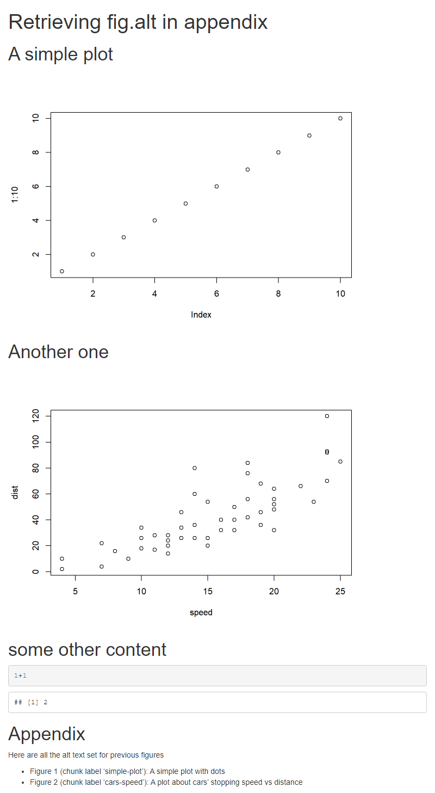

<!--
Ported from the Hugo/blogdown blog with frozen outputs: R code is not
executed. Example files, the embedded tweets and the rendered screenshot
(output.png) were copied from the blogdown-rendered index.html of the old
post; the SCSS/CSS chunks are inlined as their compiled CSS.
-->

```{=html}
<style type="text/css">
pre.yaml{margin:0px;padding-bottom:0px;border-bottom-style:none}pre.yaml code{padding-bottom:0px}pre.yaml+pre.md,pre.yaml+pre.markdown{border-top-style:none;padding-top:0px}pre.yaml+pre.md code,pre.yaml+pre.markdown code{padding-top:0px}
img.embeded-rmd {
  border-style: solid;
  border-color: grey;
}
</style>
<script src="widgets.js"></script>
```

Recently, I was pinged on Twitter about a 'How to' with **rmarkdown** and **knitr**

```{=html}
<blockquote class="twitter-tweet" align="center" data-width="550" data-lang="en" data-dnt="true" data-theme="light"><p lang="en" dir="ltr">Is there an existing function/structure to scrape the alt-text from knitr chunks in an Rmd?<br>I want to collate the descriptions for an appendix for the pdf rendering.<a href="https://twitter.com/hashtag/Rstats?src=hash&amp;ref_src=twsrc%5Etfw">#Rstats</a> <a href="https://twitter.com/rstudio?ref_src=twsrc%5Etfw">@Rstudio</a></p>&mdash; Dr Simonis (they/them) knows what chem weapons are (@JuniperLSimonis) <a href="https://twitter.com/JuniperLSimonis/status/1408886794297307137?ref_src=twsrc%5Etfw">June 26, 2021</a></blockquote>

<blockquote class="twitter-tweet" data-conversation="none" align="center" data-width="550" data-lang="en" data-dnt="true" data-theme="light"><p lang="en" dir="ltr">Right, yes, those parts of knitr look very complicated to me! Perhaps <a href="https://twitter.com/apreshill?ref_src=twsrc%5Etfw">@apreshill</a> <a href="https://twitter.com/chrisderv?ref_src=twsrc%5Etfw">@chrisderv</a> and <a href="https://twitter.com/xieyihui?ref_src=twsrc%5Etfw">@xieyihui</a> could guide us on how to make that work for the alt text also.</p>&mdash; Ben Marwick (@benmarwick) <a href="https://twitter.com/benmarwick/status/1408910726580736000?ref_src=twsrc%5Etfw">June 26, 2021</a></blockquote>
```

The idea is simple:

::: {.center style="text-align:center"}
Can we retrieve all alternative texts set with `fig.alt` chunk option[^figaltopt] to display them in an appendix at the end of the document ?
:::

[^figaltopt]: If you are not familiar with this chunk option, this is a new one added in knitr 1.32 to set alternative text on any figures inside code chunk. More about it on the [This blog post](https://blog.rstudio.com/2021/04/20/knitr-fig-alt/).

There is not a straightforward way but using a few **knitr** tricks, this can be done. Let's take this small example file:

````yaml
---
title: Retrieving fig.alt in appendix
output: html_document
---
````

````markdown

# A simple plot

```{r simple-plot, fig.alt = "A simple plot with dots", echo = FALSE}
plot(1:10)
```

# Another one

```{r cars-speed, fig.alt = "A plot about cars' stopping speed vs distance", echo = FALSE}
plot(cars)
```
# some other content

```{r}
1+1
```

# Appendix

Here are all the alt text set for previous figures

````

We would like to retrieve all the `fig.alt` set at the end of the document as a bullet point list. This can be done using advanced knitr features:

* `knitr::all_labels()` which allows to retrieve all chunk labels in a document. You can find a usage example in the R Markdown Cookbook about how to [Put together all code in the appendix](https://bookdown.org/yihui/rmarkdown-cookbook/code-appendix.html#code-appendix)
* `knitr::knit_code` which allows to retrieve code content from any chunk using its labels. The object return contains chunk options in attributes. This [post by Emi Tanaka](https://emitanaka.rbind.io/post/knitr-knitr-code/) gives a nice introduction on what this can do. This is a really advanced feature to use with caution. See at leas `?knitr::knit_code` before using it!
* `result='asis'` and `knitr::knit_expand()` [to generate Rmd source from variable](https://bookdown.org/yihui/rmarkdown-cookbook/knit-expand.html).

Putting this together, we would do first

* Retrieve the chunks with a `fig.alt` labels
* Retrieve the options set on these chunks to get the `fig.alt` one

```r
# get all labels from chunk with fig.alt chunk option defined
chunks_with_alt <- knitr::all_labels(nzchar(fig.alt))
# Use these labels to retrieve code content 
chunks_content <- knitr::knit_code$get(chunks_with_alt)
# retrieve specifically chunk options
chunks_opts <- lapply(chunks_content, function(x) attr(x, "chunk_opts"))
```

Then we would write our markdown content, for example using `knitr::knit_expand` as templating mechanism. We want something like this in markdown to obtain a list in HTML

````markdown
* Figure 1 (chunk label 'plot-1): An alt text
````

This would be generated by looping on selected chunk option to create these markdown strings.

```r
# Looping over the selected chunks
l <- lapply(seq_along(chunks_opts), function(opt_ind) {
  # We use the index number but we need the option content
  opt <- chunks_opts[[opt_ind]]
  knitr::knit_expand(
    # template string to fill in using index...
    text = "* Figure {{opt_ind}} (chunk label '{{label}}'): {{alt_text}}", 
    # and the alt text set...
    alt_text = opt$fig.alt,
    # and the label of the chunk
    label = opt$label)
})
# Using cat() to output the string content to be included as-is.
cat(unlist(l), sep = "\n")
```

The code above could be included in a single Rmd document like this, using the correct chunk option to hide the code and output the markdown strings as is.

````yaml
---
title: Retrieving fig.alt in appendix
output: html_document
---
````

````markdown

# A simple plot

```{r simple-plot, fig.alt = "A simple plot with dots", echo = FALSE}
plot(1:10)
```

# Another one

```{r cars-speed, fig.alt = "A plot about cars' stopping speed vs distance", echo = FALSE}
plot(cars)
```

# some other content

```{r}
1+1
```

# Appendix

Here are all the alt text set for previous figures

```{r retrieve-chunk-opt, include= FALSE}
# get all labels from chunk with fig.alt chunk option defined
chunks_with_alt <- knitr::all_labels(nzchar(fig.alt))
# Use these labels to retrieve code content 
chunks_content <- knitr::knit_code$get(chunks_with_alt)
# retrieve specifically chunk options
chunks_opts <- lapply(chunks_content, function(x) attr(x, "chunk_opts"))
```

```{r write-appendix, results='asis', echo = FALSE}
# Looping over the selected chunks
l <- lapply(seq_along(chunks_opts), function(opt_ind) {
  # We use the index number but we need the option content
  opt <- chunks_opts[[opt_ind]]
  knitr::knit_expand(
    # template string to fill in using index...
    text = "* Figure {{opt_ind}} (chunk label '{{label}}'): {{alt_text}}", 
    # and the alt text set...
    alt_text = opt$fig.alt,
    # and the label of the chunk
    label = opt$label)
})
# Using cat() to output the string content to be included as-is.
cat(unlist(l), sep = "\n")
```
````

After rendering, the resulting document would look like this

{.embeded-rmd fig-alt="resulting html document with appendix" width=400}

```{=html}

```

This is a rather advanced solution using some of the less-known feature of **knitr**. I am sure there could also be another approach using the [**parsermd**](https://rundel.github.io/parsermd/) by [`@rundel`](https://github.com/rundel) which helps you parse a Rmd file, including chunk option. However, that would mean reading the Rmd file during rendering of the same Rmd file... but why not ! I let you try.

For more recipes about R Markdown, don't forget to read the [R Markdown Cookbook](https://bookdown.org/yihui/rmarkdown-cookbook/) from which some of the tricks here are based !
