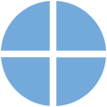
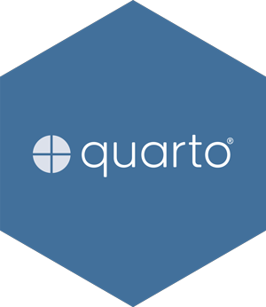
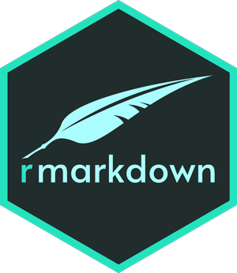
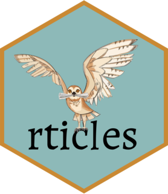
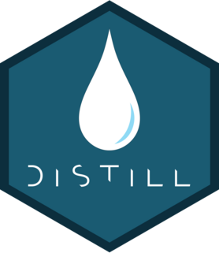
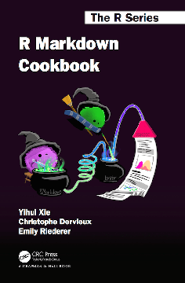

<!--
How to add a project: copy a `::: {.gw-talk-item .gw-project}` block in the right section.
First line: the logo, then the title link and optional badges. A logo is either an
image in images/projects/ (`{.gw-project-logo}`, hex stickers come from
https://github.com/rstudio/hex-stickers, `thumbs/`) or a Bootstrap icon tile
(`[[]{.bi .bi-NAME}]{.gw-project-logo .gw-project-icon}`).
Second line: the summary. Third line: the meta line (role · language).
Styles: styles/site.css.
Facts here must stay confirmed by Christophe (see the blog-post skill, "Facts about Chris").
-->

::: {.gw-talks}

## Quarto

::: {.list .gw-talk-list}
::: {.gw-talk-item .gw-project}
{.gw-project-logo .gw-project-round} [quarto-cli](https://github.com/quarto-dev/quarto-cli){.gw-talk-title}

[The current Quarto: an open-source publishing system for scientific and technical documents, built on Pandoc.]{.gw-talk-summary}

[Quarto team at Posit, most of my work · TypeScript, Lua]{.gw-talk-meta}
:::

::: {.gw-talk-item .gw-project}
{.gw-project-logo .gw-project-round} [q2](https://github.com/quarto-dev/q2){.gw-talk-title} [Next]{.gw-talk-kind}

[The next version of Quarto, a rewrite in Rust. This site is built with it.]{.gw-talk-summary}

[Quarto team at Posit · Rust]{.gw-talk-meta}
:::

::: {.gw-talk-item .gw-project}
{.gw-project-logo} [quarto R package](https://github.com/quarto-dev/quarto-r){.gw-talk-title} [CRAN]{.gw-talk-kind}

[Render and work with Quarto documents from R.]{.gw-talk-summary}

[Maintainer at Posit · R]{.gw-talk-meta}
:::
:::

## R Markdown

::: {.list .gw-talk-list}
::: {.gw-talk-item .gw-project}
{.gw-project-logo} [rmarkdown](https://github.com/rstudio/rmarkdown){.gw-talk-title} [CRAN]{.gw-talk-kind}

[Dynamic documents for R, and the base of a family of output format packages.]{.gw-talk-summary}

[Co-maintainer at Posit · R]{.gw-talk-meta}
:::

::: {.gw-talk-item .gw-project}
{.gw-project-logo} [rticles](https://github.com/rstudio/rticles){.gw-talk-title} [CRAN]{.gw-talk-kind}

[R Markdown templates for journal articles.]{.gw-talk-summary}

[Maintainer at Posit · R]{.gw-talk-meta}
:::

::: {.gw-talk-item .gw-project}
{.gw-project-logo} [distill](https://github.com/rstudio/distill){.gw-talk-title} [CRAN]{.gw-talk-kind}

[R Markdown format for scientific and technical writing on the web.]{.gw-talk-summary}

[Maintainer at Posit · R]{.gw-talk-meta}
:::

::: {.gw-talk-item .gw-project}
[[]{.bi .bi-easel}]{.gw-project-logo .gw-project-icon} [revealjs](https://github.com/rstudio/revealjs){.gw-talk-title} [CRAN]{.gw-talk-kind}

[R Markdown format for reveal.js slides.]{.gw-talk-summary}

[Maintainer at Posit · R]{.gw-talk-meta}
:::

::: {.gw-talk-item .gw-project}
[[]{.bi .bi-layout-sidebar-reverse}]{.gw-project-logo .gw-project-icon} [tufte](https://github.com/rstudio/tufte){.gw-talk-title} [CRAN]{.gw-talk-kind}

[Tufte-style handouts and books, in HTML and PDF.]{.gw-talk-summary}

[Maintainer at Posit · R]{.gw-talk-meta}
:::

::: {.gw-talk-item .gw-project}
[[]{.bi .bi-arrow-left-right}]{.gw-project-logo .gw-project-icon} [pandoc](https://github.com/cderv/pandoc){.gw-talk-title} [CRAN]{.gw-talk-kind}

[Install, manage and run several Pandoc versions from R, made to help test the R Markdown packages against each Pandoc release.]{.gw-talk-summary}

[Author and maintainer at Posit · R]{.gw-talk-meta}
:::

::: {.gw-talk-item .gw-project}
{.gw-project-logo .gw-project-cover} [R Markdown Cookbook](https://pkg.yihui.org/rmarkdown-cookbook/){.gw-talk-title} [Book]{.gw-talk-kind}

[Short, practical recipes for R Markdown, co-written with Yihui Xie and Emily Riederer (2020).]{.gw-talk-summary}

[Co-author · Chapman & Hall/CRC, free online]{.gw-talk-meta}
:::
:::

## Coding with AI agents, on Windows

::: {.list .gw-talk-list}
::: {.gw-talk-item .gw-project}
[[]{.bi .bi-cloud-check}]{.gw-project-logo .gw-project-icon} [sandbox-cloud-setup](https://github.com/cderv/sandbox-cloud-setup){.gw-talk-title}

[A reproducible setup for Claude Code cloud environments: one setup script, opt-in tools per environment, a guard that keeps secrets out of the agent's context.]{.gw-talk-summary}

[Author · Shell, Python]{.gw-talk-meta}
:::

::: {.gw-talk-item .gw-project}
[[]{.bi .bi-windows}]{.gw-project-logo .gw-project-icon} [r-bucket](https://github.com/cderv/r-bucket){.gw-talk-title}

[A Scoop bucket to install and update R, RStudio, Positron, Quarto, q2 and related tools on Windows.]{.gw-talk-summary}

[Author · Scoop manifests]{.gw-talk-meta}
:::
:::

## Earlier projects

::: {.list .gw-talk-list}
::: {.gw-talk-item .gw-project}
[[]{.bi .bi-lightning-charge}]{.gw-project-logo .gw-project-icon} [opendatarte](https://github.com/cderv/opendatarte){.gw-talk-title}

[An R client for the RTE open data API (data.rte-france.com), from my time at RTE.]{.gw-talk-summary}

[Author · R · 2019]{.gw-talk-meta}
:::

::: {.gw-talk-item .gw-project}
[[]{.bi .bi-shield-lock}]{.gw-project-logo .gw-project-icon} [proxyconfig](https://github.com/cderv/proxyconfig){.gw-talk-title}

[Helpers and RStudio addins to configure a corporate proxy for R.]{.gw-talk-summary}

[Author · R · 2019]{.gw-talk-meta}
:::

::: {.gw-talk-item .gw-project}
[[]{.bi .bi-car-front}]{.gw-project-logo .gw-project-icon} [bfr](https://github.com/cderv/bfr){.gw-talk-title}

[Get French traffic forecasts from Bison Futé in R.]{.gw-talk-summary}

[Author · R · 2018]{.gw-talk-meta}
:::
:::

:::

::: {.mt-4}
More on [GitHub](https://github.com/cderv). Hex stickers from [rstudio/hex-stickers](https://github.com/rstudio/hex-stickers).
:::
