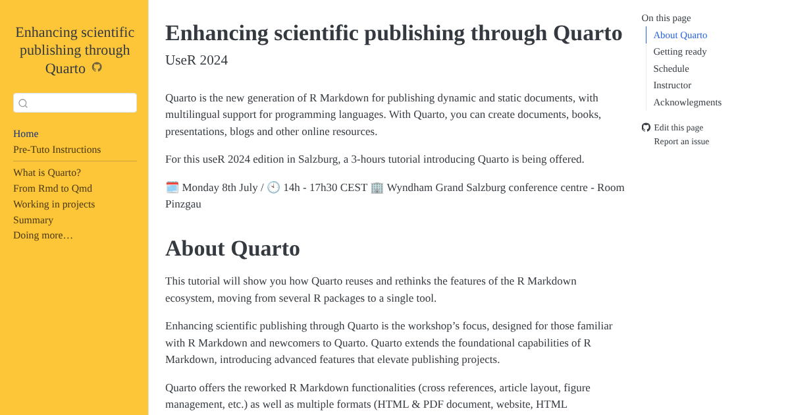

Tutorial.

At [useR! 2024](https://userconf2024.sched.com/event/1c8xA/tutorial-getting-started-with-quarto-for-your-scientific-publications-christophe-dervieux-posit-pbc), Salzburg, Monday, July 8, 2024, 14:00–17:30. A three-hour introduction to Quarto for scientific publishing, for R Markdown users and newcomers alike: what Quarto is, moving from R Markdown, and working in projects. The site has the slides, the exercises and their solutions.

[[Materials](https://cderv.dev/user2024-tutorial-quarto/) · [Code](https://github.com/cderv/user2024-tutorial-quarto)]{.gw-talk-links}

[{fig-alt="Home page of the tutorial site, Enhancing scientific publishing through Quarto"}](https://cderv.dev/user2024-tutorial-quarto/)
