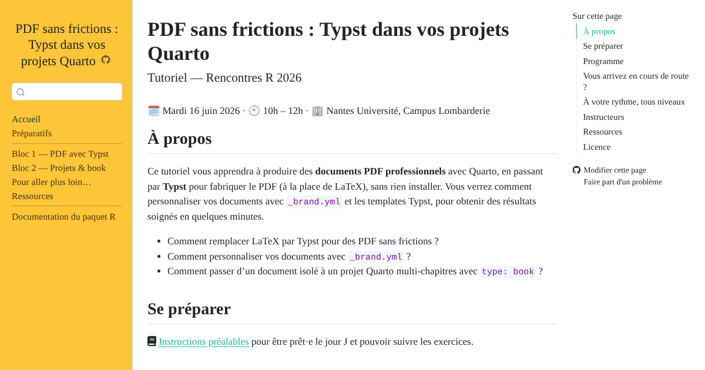

Tutorial. In French. With Maëlle Salmon.

At the [Rencontres R 2026](https://rr2026.sciencesconf.org/), Nantes Université, Tuesday, June 16, 2026, 10:00–12:00. Two hours to produce professional PDF documents with Quarto and Typst, without LaTeX: a first PDF in a few minutes with `format: typst` and `_brand.yml`, then from a single document to a multi-chapter book. A companion R package, `tutoquartotypst`, checks the setup and installs the exercises.

[[Materials](https://cderv.dev/tuto-quarto-typst-rr-2026/) · [Code](https://github.com/cderv/tuto-quarto-typst-rr-2026) · [R package](https://cderv.r-universe.dev/tutoquartotypst)]{.gw-talk-links}

[{fig-alt="Home page of the tutorial site, PDF sans frictions : Typst dans vos projets Quarto"}](https://cderv.dev/tuto-quarto-typst-rr-2026/)
