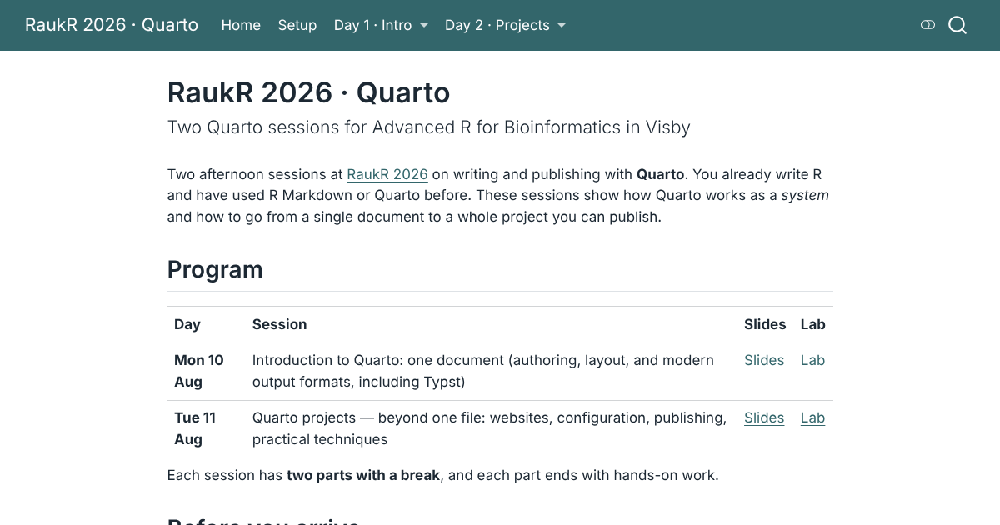

Workshop.

Two afternoon sessions at [RaukR 2026](https://nbisweden.github.io/raukr-2026/), the Advanced R for Bioinformatics summer school in Visby, Gotland, for people who already write R and have used R Markdown or Quarto.

- **Mon 10 Aug, Introduction to Quarto**: authoring, layout and output formats, including Typst.
- **Tue 11 Aug, Quarto projects**: websites, configuration, publishing and practical techniques.

Each session has slides and a hands-on lab, with solutions.

[[Workshop site](https://cderv.dev/raukr-2026-quarto/) · [Code](https://github.com/cderv/raukr-2026-quarto) · [Exercises](https://github.com/cderv/raukr-2026-quarto-exercises)]{.gw-talk-links}

[{fig-alt="Home page of the workshop site, RaukR 2026 · Quarto"}](https://cderv.dev/raukr-2026-quarto/)
